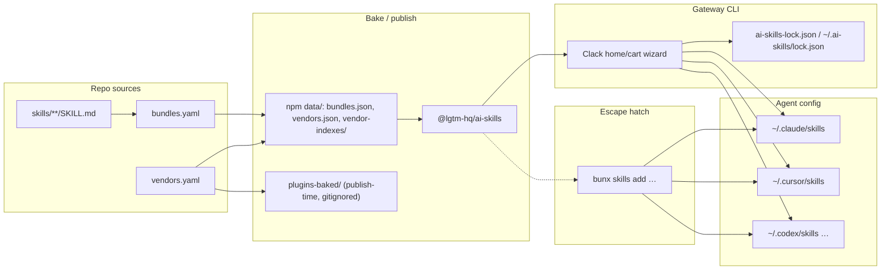

# Contributing to ai-skills

Thanks for helping improve this shared **Agent Skills** library.

## Organization-wide expectations

LGTM-HQ’s cross-repo contributor guidance lives in the
**[`.github` repository](https://github.com/lgtm-hq/.github)**. Read it alongside this
document:

- **[Contributing (org)](https://github.com/lgtm-hq/.github/blob/main/CONTRIBUTING.md)**
- **[Code of Conduct](./CODE_OF_CONDUCT.md)**

## What belongs in this repo

- **Manifest:** `ai-skills.yaml` is the source of truth for publication and
  pinned imports. Run `uv run ai-skills-engine manifest validate --terminology`
  to validate it. The v1 JSON Schema is published at
  `schemas/ai-skills.v1.schema.json`. `bundles.yaml` and `vendors.yaml` are derived
  compatibility files; regenerate them with
  `uv run ai-skills-engine manifest legacy`. CI uses the same writer with
  `--check` to fail on byte drift. `manifest migrate` is a one-shot migration
  from legacy registries and refuses to overwrite an existing manifest.
  The `x-legacy-format` extension retains original bytes as hexadecimal layout
  snapshots (short chunks avoid interpreting embedded YAML as prose), while
  every generated value comes from manifest declarations. The `other` package
  preserves the old ungrouped selection without adding it to host marketplaces.
  Manifest loading also rejects comments immediately after quoted scalars
  (`branch: "main"#comment`): PyYAML and Renovate's permissive YAML parser
  accept those bytes, but YAML requires whitespace before the comment.
  Validation and compatibility publication share this lexical check.
  Each `vendors[].sha` must appear directly as an unescaped 40-hex scalar,
  either plain or ordinary single/double quoted. Escape sequences, folded/block
  scalars, YAML anchors (`&`), aliases (`*`) and tags are rejected before
  rendering, writing or checking either compatibility registry. Errors name
  the vendor index and ID. This source rule lets native Renovate update one
  vendor's pin safely; escaped SHA text cannot be replaced, and shared SHA
  anchors would update multiple vendors. Repository, branch and other field
  spellings retain their existing validation rules.
  Legacy output rejects payload roles/paths it cannot represent; it never
  invents install behavior for newer declarations.
  `uv run ai-skills-engine inventory --json` observes local payloads, stable
  qualified IDs, sorted SHA-256/mode records, direct declared edges and shared
  resources. Both inventory and `manifest validate` include inventory diagnostics
  and exit nonzero on errors. Prose mentions and actual Markdown destinations
  produce lint only; they never create dependency edges. Code fences and code
  spans are inert. External local links must stay within that capability's
  explicitly referenced resources; a resource declaration in another package
  alone does not grant access. Resource Markdown uses the same boundary.
  Tree digests hash compact ASCII JSON arrays of sorted path/hash/mode triples;
  payload modes are canonical Git-like `0644` (no owner execute bit) or `0755`
  (owner execute bit set), for files in capability and resource payloads alike.
  Other permission and special bits and directory permissions are not identity;
  timestamps are also excluded. Owner execution matches Git and survives the
  fetcher's safe tar data filter; group/other-only execution is not preserved
  by that filter and does not mark a payload executable. Thus equivalent local
  snapshots under umask `002` or `022` and fetched trees have the same digests.
  Collection observes these modes without changing source permissions or
  authorizing or executing vendor code.
  Host-specific frontmatter retains canonical JSON values and explicit rules
  from the wheel's `data/host_attributes.yaml`. Unknown hosts and strict
  `unverified` rules refuse; collection does not certify host semantics.
  YAML dates and timestamps use `{"$yaml":"date|datetime","value":"ISO-8601"}`.
  Mappings with non-string keys or a literal `$yaml` key use
  `{"$yaml":"mapping","items":[[key,value],...]}`, sorted by canonical JSON
  key, preserving key types without string collisions. Other JSON values retain
  their shapes. Unsupported types, non-finite floats, recursive aliases, depth
  over 64 or expansion over 10,000 nodes raise `inventory.invalid-host-attribute`
  errors while retaining the capability, payload and declared edges. Such an
  inventory is invalid for use; an omitted attribute never authorizes projection.

  Compatibility publication also requires explicit exports for every local
  marketplace package and mapped vendor package. Narrowed exports or vendor
  selectors fail before either generated registry is written. An explicit
  include of every mapped package and an empty exclude list are supported;
  narrower selection requires a manifest-aware publisher. Exporting the reserved
  ungrouped package is rejected because legacy marketplaces cannot publish it.
  Non-empty capability `requires`/`resources` and local package `resources` also
  require manifest-aware publication. Empty declarations and advisory `related`
  metadata remain compatible with legacy output.
  Local capabilities require an explicit `id` alongside `path`; migration
  records the legacy skill name as that ID. This follows ADR 0011's stable
  identity contract so moving a payload never silently changes its identity.
  The Python engine ships a generated schema resource so installed commands work
  without this checkout. Regenerate it and the npm schema data with
  `uv run ai-skills-engine package-sync`; `package-sync --check` rejects drift
  from the published schema. Edit only the canonical file under `schemas/`.

- **Selection:** `uv run ai-skills-engine plan [--json]` explains every capability
  and resource without writing a lock or installation. Supply offline snapshots
  with `--vendor-root ID=PATH`; planning never fetches or executes vendor code.
  Local packages and consumer vendor declarations accept `include` and `exclude`:
  absent include roots all eligible capabilities, while `include: []` roots none.
  Includes expand declared `requires` and resources across package boundaries;
  related references and prose mentions only produce directional dangling warnings.
  Every explicit selector must match a qualified ID, package or `publisher/*`
  (or a trailing wildcard), before destination aliases or content hashes are
  considered. A bare publisher is invalid.
  Resource exclusions are supported; file/path selectors are invalid. Exclusions,
  consumer role restrictions, origin denies and collision skips veto expansion;
  a retained dependency on a vetoed target fails with the shortest chain and fix.
  Cyclic requirements are one selection unit. Namespace reports reserve declared
  aliases even when their owner is selected out or skipped; skipping an alias
  owner does not release its reservation. A directly excluded or denied root
  remains vetoed without an error unless a retained capability requires it.
  Catalog collisions need persisted `overrides.collisions` rename/skip or a
  narrower selection; equal bytes alone
  cannot resolve catalog ownership. Capability-wide renames of multi-key MCP or
  lifecycle configurations fail; split them into single-key capabilities or skip
  the conflicting capability. Rejected payload identities come only from typed
  declarations or discovery. They may satisfy exclusions but never authorize a
  payload. Payload diagnostics outside the retained closure do not block planning;
  retained failures, required resource grants and structural errors remain fatal.
  Explicit identity migrations preserve old selectors after an ID move;
  path/display moves alone keep stable IDs.
  Publisher-local vendor migrations can supply identity metadata, while consumer
  policy and collision decisions remain authoritative. Full authenticated lineage,
  lock persistence, deduplication and install projection belong to later stages.

- **Offline vendor validation:** use `manifest validate --vendor-root ID=PATH`
  for each locally available vendor checkout. Its own `publisher.id` identifies
  its packages. Consumer mapping is rejected when that checkout supplies a
  manifest. Imported policy, overrides and extensions produce ignored-authority
  diagnostics and are removed from the imported model; consumer policy is never
  merged with them. Validation performs no fetches or vendor execution. Without
  local vendor manifests, only consumer-mapped package exports can be resolved.
  In v1, persisted collision records use `capability`, `action` (`keep`, `rename`
  or `skip`) and a required `name` for `rename`.
- **Inventory vendor inputs:** `inventory --vendor-root ID=PATH` reads explicit
  offline snapshots, reporting that inventory has not verified their revision.
  Missing inputs remain `inventory.vendor-unavailable` warnings; references to
  their absent capabilities still fail. `inventory --fetch-vendors` explicitly
  acquires missing trees with the existing SHA-pinned bake fetcher. Collection
  hashes vendor files without importing modules, running scripts, hooks, commands
  or endpoints, and never rewrites supplied snapshots. Fetched trees are validated
  pristine: any symlink, including an unrelated documentation alias, fails the
  fetch before collection. Legacy bake's documentation-alias pruning stays
  confined to baking. A manifest vendor's own
  publisher names its IDs; consumer authority remains separate. Legacy
  `renameSkills` creates destination aliases. Legacy `extraFiles` declares
  resources named by lowercase file stem (underscores become hyphens), and
  per-name `resources` references grant capability access. A mapping with roots
  only uses the vendor alias as its package ID. Explicit migrations resolve old
  edge targets to current identities; inventory does not implement selection or
  dependency closure. Other roles require explicit manifest declarations:
  Markdown instructions (`.md`/`.mdc`), specialists and workflows (`.md`), command
  event registrations (`hooks` JSON), or MCP server configurations (`mcpServers`
  JSON). Unsupported shapes fail visibly without guessing a dialect.
- **Skills:** each skill is `skills/<name>/SKILL.md` with YAML frontmatter (`name`,
  `description`, …) following the conventions used by existing skills.
- **Index:** after adding, renaming, or removing skills, **`AGENTS.md` must stay in
  sync**. CI runs `scripts/generate_agents_md.py` / validation; run the same checks
  locally before opening a PR (see below).
- **Plugins:** assign each skill to a package in **`ai-skills.yaml`** (or
  to package `other` until it joins a named publication). Each package needs a
  kebab-case **`id`** (the installable plugin name). Regenerate
  **`.claude-plugin/marketplace.json`**, **`.cursor-plugin/marketplace.json`**
  and the Codex **`.agents/plugins/marketplace.json`** with
  `uv run ai-skills-engine generate` (or
  `uv run python scripts/generate_marketplace.py`). All three are generated
  from the artifact index (do not edit by hand); see
  [ADR 0002](docs/adr/0002-neutral-metadata-generated-adapters.md).
- **README plugin table:** the `## Plugins` table in `README.md` is generated
  from `bundles.yaml`. Release-tag / npm-version pins are generated from
  `pyproject.toml`. Regenerate with `uv run python scripts/generate_readme.py`.
- **Architecture decisions:** settled plugin-canonical _why_ lives in
  [`docs/adr/`](docs/adr/README.md). Implementation PRs follow accepted ADRs;
  a superseding ADR is the way to change one.
- **No secrets:** do not add API keys, tokens, or environment-specific paths in skill
  bodies or examples.
- **No project-session context dumps:** one-off session notes for a single project do
  not belong in the catalog ([#55](https://github.com/lgtm-hq/ai-skills/issues/55)).

## Local development

```bash
git clone https://github.com/lgtm-hq/ai-skills.git
cd ai-skills
uv sync
uv run lintro fmt
# Exit 0 alone is not audit coverage; inspect scanner results and limits below.
uv run lintro chk
uv run lintro tst
bash scripts/validate.sh
```

Use **`uv`** for Python tooling and **`lintro`** for lint/format/check — do not bypass
with raw **ruff**, **black**, etc.

The shared typed Python engine is installed editable from `src/ai_skills_engine/`
by `uv sync`. Its author CLI is `uv run ai-skills-engine --help`; existing
`uv run python scripts/<name>.py` commands remain compatibility entry points.
For example, `uv run ai-skills-engine generate --check` runs the same
implementation as `scripts/generate_marketplace.py --check`. Commands discover a
repository by walking up from cwd for `pyproject.toml` and `skills/`, or accept
`--repo-root PATH`. Relative file operands retain their cwd-relative meaning.
Tests import and monkeypatch the real package modules, never the script shims.
The ordinary Python suite needs neither Bun nor npm dependencies. The gateway
gate runs `scripts/ci/npm/manifest_yaml_boundary_tests.py` explicitly after its
locked Bun dependency install. That required offline comparison uses Renovate's
real production YAML parser options (`strict: false`); missing dependencies fail
the gate rather than skipping it.
`uv build` produces the typed wheel; runtime dependencies are separate from dev
tooling. Consumer runtime bundling and install commands are subsequent work under
ADR 0008.

Direct `python3 scripts/<name>.py` and executable shims load this checkout's
`src/` through a single bootstrap in `scripts/ci/npm/_engine_bootstrap.py`.
They require the same third-party runtime dependencies as their implementations;
the manifest generator remains stdlib-only. Installed CLI imports do not use the
checkout bootstrap. Release-manifest backfills check out tooling from the workflow
revision separately, then generate against the selected tag: standalone Python
for pre-package tags, or `uv run --locked --no-dev` for package tags.

Package version normalization accepts SemVer 2.0.0 with an optional lowercase `v`
prefix and no artificial length limit. Validation scans identifiers in linear
time. It now rejects numeric prerelease identifiers with leading zeroes and
non-ASCII digits, which the former overlapping regex erroneously accepted.
Build metadata may still contain numeric identifiers with leading zeroes.

Run `bash scripts/ci/quality/prepare_node_deps.sh` before local quality checks.
It acquires each TypeScript project's dependencies separately using its frozen
lockfile and `--ignore-scripts`. The quality job does the same inside the pinned
Lintro image before the full check. Lintro's root-only auto-install cannot acquire
these nested projects. Keep the historical spike's sources and lockfile intact;
sharing a workspace introduces incompatible Bun type versions into the gateway.

Lintro runs all current and future bundled tools by default. Any explicit tool
disable in `.lintro-config.yaml` needs a reason comment. AI `idiom-review` requires
paid provider credentials and explicit opt-in under the #596 cost gate; it belongs
to `lintro review`, not `chk`.

Pylint complements Ruff, mypy, and pydoclint with cross-file duplicate-code checks
on production scripts. Its other diagnostics overlap those tools or enforce
unadopted size/complexity limits. Duplication requires 12 substantive lines so short
CLI argument wrappers and exception tuples can remain self-contained. Tests
deliberately repeat fixture arrangements and are excluded from this duplication
pass. Import-linter has no contracts here: the engine extraction preserves the
existing module dependencies and introduces no separate install layer yet.
Buf, Checkov, cppcheck, dotenv-linter, golangci-lint, html-validate, and stylelint
remain enabled and no-op until matching source files exist. Spectral has no API
specifications or ruleset to check. Commitlint uses the repository's semantic commit
types. Vale uses a small offline terminology style; typos allows probe identifiers,
shell-regex fragments, and hexadecimal hashes. Both exclude generated vendor prose.

Python dependency auditing runs through lintro's `pip_audit` and `osv_scanner`.
`requirements-audit.txt` is generated from every locked dependency group because
pip-audit's project reader does not audit dev groups. After changing `uv.lock`, run
`bash scripts/export-audit-requirements.sh`; `validate.sh` checks freshness offline.
Keep pip-audit out of dev dependencies so it cannot reintroduce `pip` into `uv.lock`.
Linux pip-audit evaluates environment markers on Linux, so Windows-only packages
such as `colorama` and `win32-setctime` are excluded. A successful Linux audit does
not establish Windows dependency coverage. A Lintro exit code alone does not prove
dependency scan coverage; inspect each scanner's result and skips.

Renovate ignores only the generated root `requirements-audit.txt` for its
`pip_requirements` manager. The org uses Mend-hosted Renovate, which does not run
`postUpgradeTasks`; `allowedCommands` is a self-hosted global option, not a
repository permission (see [py-lintro #2436](https://github.com/lgtm-hq/py-lintro/issues/2436)).
The audit-requirements regeneration workflow instead reads `pyproject.toml` and
`uv.lock` as data from same-repository Renovate PRs, runs the trusted base's offline
export helper, and appends only the generated audit file through the release App's
GitHub-signed commit action with an expected-head guard. This starts fresh CI;
freshness checks remain blocking if regeneration fails. No project dependencies
or PR scripts execute with App credentials.

Parity evidence has two narrow archival exceptions in `.lintro-ignore`:
`docs/parity/evidence/cursor/raw/` contains WRITE-ONCE returned probe bytes, and
`tests/fixtures/host-probe/cursor-macos-probe.sh` preserves the supplied personal-Mac
script byte-for-byte, including its original formatting and ShellCheck findings.
Do not execute that historical script for a new run. The maintained
`cursor-macos-probe-driver.sh` preserves the R6 isolation/failure controls and
receives the normal ShellCheck/shfmt checks and offline driver tests. Raw JSON
integrity is enforced by `tests/test_parity_evidence.py` and `raw/INDEX.sha256`;
new runs add files and digest entries without rewriting old evidence.

When you add or move skills, also run:

```bash
uv run python scripts/generate_agents_md.py
uv run python scripts/generate_marketplace.py
uv run python scripts/generate_readme.py
bash scripts/validate.sh
```

### Shared installer pins

CI bootstrap and Cursor source `scripts/tool-versions.sh` and use
`scripts/lib/fetch-verified.sh` to check installer bytes before execution.
The independent **Verify tool installer checksums** CI job always downloads and
checks both installers, even if uv or Bun is already installed. It never runs
them. A Renovate update fails if the downloaded installer bytes no longer match
the pinned checksum. A new version with identical installer bytes still passes
without changing the checksum.

To refresh a pin, update its version in `scripts/tool-versions.sh`, then download
the pinned installer and measure its bytes without executing it:

```bash
source scripts/tool-versions.sh
installer_tmp=$(mktemp -d)
trap 'rm -rf "$installer_tmp"' EXIT
curl --proto '=https' --proto-redir '=https' -fLsS \
  "$UV_INSTALLER_URL" -o "$installer_tmp/uv-install.sh"
curl --proto '=https' --proto-redir '=https' -fLsS \
  "$BUN_INSTALLER_URL" -o "$installer_tmp/bun-install.sh"
if command -v sha256sum >/dev/null 2>&1; then
  sha256sum "$installer_tmp/uv-install.sh" "$installer_tmp/bun-install.sh"
else
  shasum -a 256 "$installer_tmp/uv-install.sh" "$installer_tmp/bun-install.sh"
fi
```

Review the downloaded installer against the upstream release before recording its
measured SHA-256 in the shared pin file. Run
`bash scripts/ci/check-tool-installers.sh` to verify both pins. A mismatch reports
the expected and measured hashes and exits nonzero; verification cannot be skipped.

## Adding / updating a vendor

Third-party vendors live in root **`vendors.yaml`** (SHA-pinned). Use
`scripts/manage_vendors.py` to mutate the registry and regenerate every derived
artifact (baked `vendor-indexes/`, `NOTICE.md`, a local `plugins-baked/` tree,
and the embedded npm package data) in one step — never hand-edit the baked
indexes or plugin trees. `plugins-baked/` is a publish-time artifact
([ADR-0007](docs/adr/0007-publish-time-vendor-bake.md)); do not commit it.

```bash
# Add a vendor (all fields required; --display-ref defaults to latest)
uv run python scripts/manage_vendors.py add \
  --id owner-skills --repo owner/skills \
  --sha 0123456789abcdef0123456789abcdef01234567 \
  --skill-roots skills --license MIT \
  --homepage https://github.com/owner/skills

# Update fields on an existing vendor (only --id is required)
uv run python scripts/manage_vendors.py update --id owner-skills \
  --sha 89abcdef0123456789abcdef0123456789abcdef

# Rebake indexes + plugin trees + resync npm data without touching vendors.yaml
# (this is the Renovate path for automated vendor SHA bumps)
uv run python scripts/manage_vendors.py refresh

# Verify baked indexes and npm data are current (exits non-zero on drift).
# Plugin trees are checked when a local plugins-baked/ tree is present.
uv run python scripts/manage_vendors.py check
```

`add`/`update` still leave two edits for a human: add or update the vendor bullet in
**`README.md`** and record the change under the Unreleased section of
**`CHANGELOG.md`**. The script prints this reminder and never edits those files.

### Vendor authoring: `init`, `validate` and `add`

Any repository can become a vendor, a consumer or both with the engine CLI. None
of these commands executes vendor content.

```bash
# Scaffold ai-skills.yaml and .github/workflows/ai-skills.yml (never overwrites;
# a second run reports the existing files; --dry-run prints only)
uv run ai-skills-engine init [--dry-run] [--engine-ref SHA]

# Run every check offline; exits non-zero on any failure
uv run ai-skills-engine validate [--strict] [--format json]

# Import a pinned vendor, then lock it
uv run ai-skills-engine add owner/repo[@ref] [--include ID]... [--exclude ID]...
```

- **`init`** detects `skills/*/SKILL.md`, `agents/*.md` and existing
  `.claude-plugin`/`.cursor-plugin` manifests and proposes one package with
  qualified capability IDs plus an explicit `exports:` entry. The caller workflow
  pins the reusable `.github/workflows/ai-skills-validate.yml` and the engine to one
  full 40-hex commit SHA: `--engine-ref`, or this engine's release tag resolved
  from GitHub.
- **`validate`** runs, in order: schema and terminology lint, inventory (including
  host-specific frontmatter), selection closure and selectors, provenance, the
  ADR 0006 ingest checks on the repository's own content, the internal link check,
  the collision report, export checks, `lock --check` and `generate --check`.
  `--strict` fails missing lineage. A stage without inputs (no `ai-skills.lock`, no
  committed host marketplaces) is reported as skipped. Vendor inputs come from
  `--vendor-root ID=PATH` or the source cache (`ai-skills-engine lock --fetch`).
  A vendor manifest's `policy:`, trust grants and `overrides:` are reported as
  ignored and never applied. This catalog's CI and a fixture vendor
  (`tests/fixtures/vendors/manifest`) call the reusable workflow with `strict`.
- **`add`** resolves `ref` (default branch when omitted) to a SHA, fetches the pin
  into the source cache and runs the ingest checks. A vendor with an
  `ai-skills.yaml` gets a pinned `vendors:` entry whose `include` imports the
  upstream's `exports`. A vendor without one gets a consumer-owned `mapping`
  scaffold whose identities this repository asserts; `lock` refuses it until you
  review it and rerun `add owner/repo --accept-mapping`. Built artifacts record
  `"identity": "consumer-asserted"` for mapped capabilities. Either way, `add`
  then runs `lock`; ambiguous `sha`/`branch` scalars are written quoted.
- **Exports:** importing never re-publishes. Only packages listed under
  `exports:` are re-exported, and their lineage gains this publisher's hop. An
  export that matches nothing, or names content that is not imported, fails
  `validate`.

### Vendor plugin slices

Each vendor may declare `plugins:` — reviewed bake slices, not runtime
improvisation ([ADR-0005](docs/adr/0005-collision-doctrine.md),
[ADR-0006](docs/adr/0006-vendor-bake-safety.md)). Omit the field or use
`plugins: []` until a slice is declared; `plugins: null` is rejected.
The five registered vendors declare collision-resolved slices here; this
schema is validated whenever `vendors.yaml` loads.

Per plugin:

- `id` — kebab-case plugin id, unique across vendors and first-party
  `bundles.yaml` group ids (skipped only when a sibling `bundles.yaml`
  is absent, as in isolated tests)
- `description` — non-empty single-line string
- `skillsRoot` — canonical relative POSIX path or glob (no whitespace,
  backslashes, `.` / `..` / empty components, not absolute)
- `skills` — `"*"` (every skill under `skillsRoot`) or a non-empty list of
  canonical paths relative to `skillsRoot` (no glob metacharacters; the
  list must not contain `"*"`)
- `extraSkills` — optional repo-relative canonical paths to ingest in
  addition (no globs; omit the key rather than `null`)
- `extraFiles` — optional repo-relative files copied onto the baked plugin
  root (basename-unique; for in-skill links to a vendor README)
- `renameSkills` — optional `{old: new}` kebab-case map; targets are unique
  across **all** vendors. Collisions against first-party skill directory
  names are reported at bake/CI, not at schema load. Every
  collision rename is a reviewed registry edit, never a bake/install
  guess. Duplicate YAML keys are rejected.
- `agents` — optional non-empty list of kebab-case agent markdown
  component names (the stem of `agents/*.md` files to ingest). Omit the
  key rather than `null`. This is not a host-id allowlist.

```yaml
    plugins:
      - id: example-plugin
        description: Example vendor plugin.
        skillsRoot: skills
        skills: "*"
        extraSkills:
          - extras/bonus
        extraFiles:
          - README.md
        renameSkills:
          teach: teach-example
        agents:
          - comment-sicko
          - code-reviewer
```

`scripts/manage_vendors.py` round-trips `plugins` when refreshing SHAs. Do
not hand-edit baked indexes or a local `plugins-baked/` tree to encode a slice.

### Vendor plugin bake

`scripts/bake_vendor_plugins.py` turns declared slices into canonical
plugin trees under **`plugins-baked/`**
([ADR-0006](docs/adr/0006-vendor-bake-safety.md),
[ADR-0007](docs/adr/0007-publish-time-vendor-bake.md)). That directory is
gitignored: CI and `publish-npm.yml` bake it; the pin SHA in `vendors.yaml`
is the review point.

- Ingest exactly the registry slice (`skillsRoot` + `"*"` or paths,
  `extraSkills`, `extraFiles`, `agents` from `{repo}/agents/<stem>.md`).
  Rewrite SKILL.md frontmatter `name:` to the explode directory on every
  ingest so display-case vendor titles become kebab-case identities.
  Drop skill-root `README.md` files that typically link outside the slice.
- Apply `renameSkills` to the skill directory **and** the SKILL.md
  frontmatter `name:`. After copy (and any rename), frontmatter `name`
  must equal the skill directory name — that name is the explode
  identity used for collision checks.
- Reject symlinks, path escapes, and missing `SKILL.md`. Walk the
  entire vendor tree (including `node_modules` and `.git`) so hidden
  skills and symlinks cannot skip coverage or validation. Never execute
  vendor content.
- Write coverage (`plugins-baked/COVERAGE.md`: every un-ingested
  `SKILL.md` listed as `SKIPPED`) and fail CI on unresolved explode-name
  collisions against other baked plugins or first-party `skills/` names,
  and on agent-stem collisions across baked plugins. Coverage and
  collision reports are CI job output, not committed files.
- Stage the complete tree in a temp directory and publish it with an
  atomic directory exchange so `plugins-baked/` is never absent or mixed,
  then mirror onto the original destination inode so resident shells keep
  a valid cwd. Leftover `.plugins-baked.bak` or `.plugins-baked.hold`
  sidecars fail closed, including in `--check`.
- Write `plugins-baked/BAKE.json` (registry pin including repo + plugin
  slice + coverage renderer inputs + a path→digest inventory).
  `--check` validates a **local** tree: if `plugins-baked/` is absent it
  succeeds (no committed vendor tree to diff); if present it allowlists
  lock keys, re-derives ingested counts / explode names / collisions,
  re-renders `COVERAGE.md`, compares the lock to `vendors.yaml` and the
  local tree, and requires all four host manifests to match the
  pin-derived version. Relative Markdown links in baked plugin files
  must resolve to a file inside the plugin.
- Stamp plugin versions from `displayRef` when it is a `major.minor.patch`
  tag (optional `v` prefix and prerelease suffix); floating pins such as
  `latest` and non-tag prefixes such as `v1.2-not-a-version` use the
  short SHA.

```bash
uv run python scripts/bake_vendor_plugins.py
uv run python scripts/bake_vendor_plugins.py --check
```

The five registered vendors declare plugin slices in `vendors.yaml`. A
bake emits marketplace, coverage, and `BAKE.json` under gitignored
`plugins-baked/`. CI runs the real bake (network fetch at pinned SHAs)
rather than treating bake output as a committed drift gate. Retaining
an older vendor version long-term means promoting it to first-party
`skills/`.

### Vendor re-pin

`scripts/repin_vendor.py` resolves the upstream ref for a vendor
(`branch` takes precedence; otherwise `displayRef: latest` / missing /
`HEAD` → default-branch HEAD; any other `displayRef` is that git ref), updates
the `sha` pin, re-bakes, and prints added / removed / renamed skills, coverage
deltas, and new collisions. Unresolved collisions fail closed. Bake output stays
gitignored; the reviewable diff is the pin plus generated indexes and
npm catalog data.

```bash
uv run python scripts/repin_vendor.py --id mattpocock
uv run python scripts/repin_vendor.py --all
uv run python scripts/repin_vendor.py --id mattpocock --json
```

Renovate tracks each manifest vendor's explicit `branch` (currently `main`
for all five vendors). Its native YAML/JSONata manager discovers complete vendor
records at any valid indentation and in any field order, including comments
and indentless sequences. YAML decoding supplies repository and branch values,
so an escaped repository spelling still identifies the decoded dependency.
`manage_vendors.py add` and `update` accept `--branch` and preserve their stable
writer ordering. Vendor pins follow the SHA source contract above.

To switch an existing vendor from branch tracking to a release tag, use the
update-only `--clear-branch` flag together with `--display-ref` and the tag's
commit SHA:

```bash
uv run python scripts/manage_vendors.py update --id owner-skills \
  --clear-branch --display-ref v1.2.3 \
  --sha 89abcdef0123456789abcdef0123456789abcdef
```

`--clear-branch` removes the `branch` key and is mutually exclusive with
`--branch`. Omitting both flags preserves existing branch tracking, even when
`--display-ref` changes.

The legacy registry still rejects branch names containing quotes, whitespace
or control characters. Native discovery decodes complete YAML scalars without
truncating them; manifest loading enforces YAML comment separation even though
Renovate's production parser uses `strict: false`. The prepared gateway gate
runs the byte-verified Renovate 44.206.2 extractor and updater snapshots in
`tests/fixtures/manifest/renovate-runner.mjs`, with locked production dependency
versions. Missing Bun or dependencies fail this gate; the Python-only suite
does not require either runtime.

[`.github/workflows/vendor-pin-regen.yml`](.github/workflows/vendor-pin-regen.yml)
refreshes generated data on same-repository `renovate/**` PRs authored by
`renovate[bot]` that change `vendors.yaml`. Both jobs also require the triggering
actor to be `renovate[bot]` or `lgtm-release-bot[bot]` (including reruns). The
read-only `regenerate` job checks out the exact PR head and summarizes changed
vendors against `git merge-base base head` with `--keep-sha`; it never advances
a Renovate-selected pin. A vendor absent from the baseline is reported as `new`.
Regeneration sees only a read-only job token, never release App credentials.
A single sticky PR comment contains skill, coverage, and collision deltas.

The `publish` job checks out the exact base SHA. Only this job mints the release
App token. Both jobs use Python 3.15, matching npm publication. The publisher
uses stdlib-only helpers with `uv run --no-project`, without dependency installs
or caches shared with regeneration. Executed repository helpers come from the
trusted base checkout, but the workflow definition is selected by the PR and is
not base-trusted. This boundary assumes workflow-editing writers and the allowed
bot identities are trusted; it does not protect against a writer changing the
workflow YAML.

The handoff is a single `publication.json` data envelope containing base64
additions, path-only deletions, the head SHA, summary, and collision status.
It is downloaded under `runner.temp`, never extracted or copied over the trusted
checkout. Before minting the token and again before any API call, the trusted
reader validates its schema, expected head, canonical allowlisted paths,
duplicate paths, base64, and filesystem entries (no symlinks or extra files).
Symlinks inside the source repo are rejected; symlinks above its root are allowed.
The combined base64 contents have a conservative local budget of 20 MiB
(`MAX_BASE64_BYTES` in `scripts/ci/vendor_pin_artifact.py`), not a measured GitHub
API limit. The complete envelope has a further 1 MiB metadata allowance for the
summary, paths, and JSON overhead. The full sticky comment, including its marker
and newline, is limited to GitHub's 65,536 characters. Oversize input and JSON
nesting beyond the parser limit fail locally before credentials or API use.

Summaries run before the final refresh. Collisions produce a report-only
artifact with no changes, then fail the publishing job after posting the report.
A hard summary or refresh failure produces no publication artifact, so even a
refresh that writes partial output cannot cause a commit. No vendor code runs.
The generated envelope is validated in a temporary directory before an atomic
rename publishes `publication.json`; failed validation leaves no new final file.

Generated changes are committed with GraphQL `createCommitOnBranch`, using
`expectedHeadOid` to reject concurrent branch updates. GitHub signs these
App-authored commits, and the App push triggers CI on the new head. No diff
means no commit. Only generated catalog paths are eligible for a commit;
`plugins-baked/` remains gitignored (ADR-0007).

The existing release identity is **`lgtm-release-bot[bot]`**. Its references must
rotate together: the workflow's `RELEASE_APP_ID` / `RELEASE_APP_PRIVATE_KEY`
secrets and triggering-actor gate, `_BOT_LOGIN` in
`scripts/ci/create_signed_commit.py` (sticky comment ownership), and
`gitIgnoredAuthors` in `renovate.json` (currently
`273006376+lgtm-release-bot[bot]@users.noreply.github.com`). The App already has
**contents:write** and **pull-requests:write** on this repo; no additional App or
secrets are needed. Renovate ignores that email so it can continue rebasing.
After rollout, verify the first real vendor PR's commit verification and
required checks on its final head; those live checks cannot be proven locally.
This requires the trusted helpers to have landed on the base first. The earlier
live acceptance remains blocked by upstream vendor content errors, outside this
change. Any organization ruleset change is a separate human operation.

## Pull requests

- Use **[Conventional Commits](https://www.conventionalcommits.org/)** in PR titles;
  this repository uses **squash merge**, and the merge title may drive automated
  **semver** releases.
- Follow **`.github/PULL_REQUEST_TEMPLATE.md`** when you open a PR.
- Expect CI to run **lintro** (via the published **py-lintro** container image) and
  **`bash scripts/validate.sh`**.

## Review mindset

Skills are consumed by multiple agents; prefer **clear descriptions**, stable naming,
and **minimal required context** in each `SKILL.md`.

## Agent portability and cross-skill references

Skills are installed into multiple agents (Claude Code, Cursor, Codex, …), so skill
bodies must not assume one agent's features or tool names.

- **Cross-skill references:** reference other skills by backticked name in portable
  phrasing — e.g. "follow the `lint` skill", "see the `stand-general` skill" — never
  slash form ("see `/lint`"). Slash invocation is a Claude Code concept; other agents
  read `/lint` as opaque text. The backticked name keeps references greppable.
- **User-typed invocations are the exception:** keep the `/name` form only when
  describing something the **user** types, e.g. usage examples like
  "`/branch 123` — branch from issue #123" or "when the user invokes `/commit`".
- **Agent-specific tool names:** do not name agent-specific tools
  (e.g. `AskUserQuestion`, sub-agent types) as requirements. Describe the capability
  instead ("ask the user to confirm — use a structured question tool if available").
- **Marking agent-specific behavior:** if a step truly depends on one agent's
  capability (e.g. background sub-agents), phrase it as capability-conditional
  ("if the agent supports X, …") and provide an inline fallback so other agents can
  still complete the skill. Cite a specific agent only as an example ("e.g. Claude
  Code's …"), never as the only path.

## Architecture



Native hosts install **plugins** (see README Install). The **gateway** package
`@lgtm-hq/ai-skills` (`sk` / `skill`) currently projects a plugin through
`--bundle`; install globally with `bun add -g @lgtm-hq/ai-skills`, or for a
pinned, install-free run use `bunx --package=@lgtm-hq/ai-skills@X.Y.Z sk`.
Its Clack home/cart UI still loads baked `data/bundles.json` and vendor indexes
shipped inside the npm package (produced from `bundles.yaml` / `vendors.yaml`
at publish time), writes a gateway lockfile, and installs into agent skill
directories. The [Vercel Labs `skills` CLI](https://github.com/vercel-labs/skills)
remains the escape hatch for direct catalog installs; first-party skill paths
stay flat (`skills/<name>/`).

## CI and releases

Pull requests and pushes to `main` run **lintro** (via the published **py-lintro**
container image), the pytest suite, skill-structure validation,
`bash scripts/validate.sh`, the vendor plugin bake
(`scripts/ci/bake_vendor_plugins_gate.sh`), and two callers of the reusable
`ai-skills-validate.yml` workflow: this catalog with `strict` and the fixture vendor
in `tests/fixtures/vendors/manifest`.

**Validate Lintro Version** compares `pyproject.toml`'s exact `lintro==`
pin to the version inside the pinned `ghcr.io/lgtm-hq/py-lintro` digest on
`ci.yml` / `validate-lintro-version.yml`. Those three must move together
(Renovate's `lintro` group tracks the PyPI pin and workflow digests; the check
is a required status). Do not bump the pin alone.

Version bumps and **CHANGELOG.md** updates flow through **`lgtm-hq/lgtm-ci`**
[reusable workflows](https://github.com/lgtm-hq/lgtm-ci), called from this repo
with **full SHA pins** on `uses:` (see `.github/workflows/release-version-pr.yml`
and `release-auto-tag.yml`).

Skill retirements and other deletions belong under **`### Removed`** in
`CHANGELOG.md` ([Keep a Changelog](https://keepachangelog.com/en/1.1.0/)), not
under Other Changes or Previously Unreleased.

### CHANGELOG entry format

Every bullet that references a PR merged to `main` must end with
`(#PR) (shortsha)` — for example:

```text
- **gateway**: add manage_vendors CLI for SHA-pinned vendors (#248) (12fd543)
```

`shortsha` is the first 7 characters of the squash-merge commit on `main`.
Resolve it with:

```bash
git log --oneline | grep '(#248)'
# → 12fd543 feat(gateway): add manage_vendors CLI for SHA-pinned vendors (#248)
```

The `lgtm-hq/lgtm-ci` release-version-pr workflow appends this pair
automatically for generated entries. Human-authored bullets — for example when
recording a vendor addition or a manual CHANGELOG update — must follow the same
convention.

Entries that reference draft or abandoned PRs that were never merged to `main`
have no resolvable commit SHA; leave them without the shortsha suffix rather than
inventing one.

**Baseline note:** Caller pins are mostly
`768a6b72f0a5346b5ecba3f4e13b90040472341c` (**v0.52.4**). Link Check alone pins
`c4192f9d97fa79767241d85d0d8e4cba866dcdec` (post-v0.52.3 lychee-action output
fix; re-verify when bumping).

When a release is published, `.github/workflows/release-manifest.yml` runs
`scripts/generate_skills_manifest.py` to build **`skills-manifest.json`** (skill
name → sha256 of its `SKILL.md`), attests it with GitHub build provenance, and
attaches it to the GitHub Release. The manifest is generated **at release time
only** — it is not committed, so skill edits do not churn a checked-in file. CI
(`scripts/validate.sh`) verifies the generator is deterministic.

## Publishing `@lgtm-hq/ai-skills` (npm)

The gateway package lives in `npm/ai-skills/` (version `0.0.0-dev` on `main`).
Release tags use `vX.Y.Z`; the package version injects `X.Y.Z` to match.
Publishing uses **npm trusted publishing (OIDC)** via
`.github/workflows/publish-npm.yml` and the GitHub **`npm` environment**
(maintainer approval), mirroring
[py-lintro](https://github.com/lgtm-hq/py-lintro).

The publisher's egress policy stays `block`. During the first release after a
toolchain or provenance change, inspect Harden Runner's denied endpoints and
update the explicit allowlist only for verified publishing requirements. PR
checks do not exercise the release OIDC/provenance exchange.

Before the first live publish:

1. Configure a trusted publisher on npmjs for `@lgtm-hq/ai-skills` pointing at
   this repository and workflow.
2. Ensure the GitHub Environment named `npm` exists with required reviewers.
3. Dry-run with `workflow_dispatch` using `release_tag: vX.Y.Z` and
   `dry_run: true` until the tarball looks right; then allow a real release
   publish.

The publish job bakes vendor plugin slices, then syncs embedded
`vendors.yaml`, baked indexes, `NOTICE.md`, and the fresh
`plugins-baked/` tree into the package before `npm publish`. Bake output
is not committed; published tarballs are the immutable record
([ADR-0007](docs/adr/0007-publish-time-vendor-bake.md)).

## Skill content policy

Skills are executable influence: every `SKILL.md` becomes instructions inside a
consumer's agent. Contributions are reviewed against this policy, and reviewers
(human or AI) should treat violations as blocking.

Skills **must not** instruct agents to:

- **Exfiltrate data** — send file contents, credentials, environment variables,
  or conversation context to external endpoints, or encode them into URLs,
  commit messages, or other side channels.
- **Weaken safety checks** — disable permission prompts, bypass sandboxes,
  suppress confirmation flows, edit agent configuration/policy files, or tell
  the agent to ignore other instructions.
- **Run unguarded destructive commands** — `rm -rf`, `git push --force`,
  `git reset --hard`, mass file rewrites, or anything irreversible without the
  gates below.

Destructive operations, where genuinely needed, **require both**:

- **A confirmation gate** — the skill must have the agent present exactly what
  will be destroyed and wait for explicit user confirmation before executing.
- **Path-safety checks** — resolve paths to canonical form and verify they are
  non-empty, exist, are not `/` or the home directory, sit under an expected
  prefix, and are not symlinks escaping that prefix.

The reference pattern is **`skills/reconcile`** (Phase 5 — Execute): it prefers
the safe tool (`git worktree remove`), gates the `rm -rf` fallback behind
explicit user confirmation, and runs the path-safety checklist above before any
delete. New skills with destructive steps should copy that structure.

Additional requirements:

- **No secrets** in skill bodies or examples (also listed above); never
  instruct agents to read or transmit credential files.
- **Network calls** must be limited to what the skill's stated purpose needs,
  target named first-party endpoints (no attacker-controllable URLs built from
  repo or conversation content), and never carry local data beyond what the
  user asked to publish.
- **Prefer reversible operations** and the least-privileged command that does
  the job.
